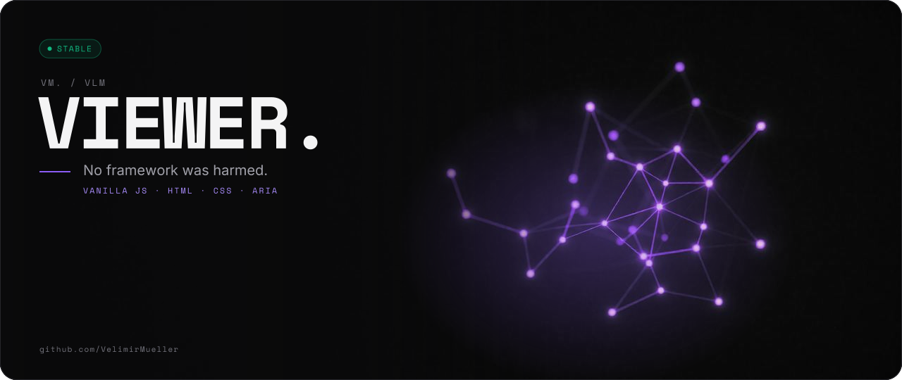

<picture>
  <source media="(prefers-color-scheme: light)" srcset="assets/banner/hero-v1-light.svg">
  
</picture>

   

> No framework was harmed.

```text
██  ██  ██████  ██████  ██   ██  ██████  █████
██  ██    ██    ██      ██   ██  ██      ██  ██
██  ██    ██    █████   ██ █ ██  █████   █████
 ████     ██    ██      ███████  ██      ██ ██
  ██    ██████  ██████   ██ ██   ██████  ██  ██  ██
```

## // 01 WHAT IT DOES

- Shows a list of articles in an overlay. Select an article to read its headline and text. The articles come from `data/articles.json`.
- Fully responsive
- Performant DOM updates with fragments
- Dynamic ARIA-attribute handling
- Smart UI with debouncers to deliver fantastic UX

Written in plain HTML/CSS and JS.

No build step, no dependencies, no framework: the browser loads the ES modules directly. The UI text is German.

## // 02 QUICK START

Serve this project via a webserver or if you have docker compose installed run 

`docker compose build && docker compose up -d`

to serve this project via http://localhost:8080

Without Docker, any static server works if it serves the repo root, because the page fetches `/data/articles.json` by absolute path. For example:

```sh
python3 -m http.server 8080
```

Opening `index.html` straight from disk (`file://`) does not work: browsers block ES modules and `fetch()` there.

## // 03 HOW IT WORKS

```text
  browser  ·  http://localhost:8080  (nginx:alpine)
     │  GET index.html · css/main.css · js/index.js (ES modules)
     ▼
  ┌────────────────────────────┐   fetch()   ┌───────────────────────┐
  │  index.html module script  │ ──────────▸ │  data/articles.json   │
  │  fetchArticles()           │ ◂────────── │  id · headline · text │
  └─────────────┬──────────────┘    JSON     └───────────────────────┘
                │  createArticleButtons(): buttons built in one
                ▼  DocumentFragment, one DOM update for all of them
  ┌────────────────────────────┐
  │  #overlay                  │  "Alle Kategorien" opens it,
  │  aside: article buttons    │  close button or Escape closes it
  │  article: headline + text  │  focus · click   → show at once
  └────────────────────────────┘  mouseover       → 300 ms debounce

  aria-hidden / aria-inert follow the overlay and side-menu state
  below 768 px the article list sits behind a side-menu toggle
```

### Project layout

```text
index.html            markup + the module script that wires everything up
data/articles.json    the articles: id, headline, text (HTML)
js/articles/          fetch, button factory, button event listeners
js/aria/              aria attributes for the overlay and its buttons
js/utility/           overlay state, side menu, debouncer, Escape key
css/                  variables, layout, components, utilities
fonts/                Roboto Regular + Bold
Dockerfile            nginx:alpine image that serves the folder
docker-compose.yml    port 8080 -> 80, mounts the folder into nginx
```

## // 04 USAGE

### Articles

Edit `data/articles.json`. Each entry is `{ "id", "headline", "text" }`; one button per entry is created at load time. `text` is inserted as HTML, so `<strong>` and `<br>` work — only put trusted content there.

### Reports


## // 05 STATUS

| | |
|---|---|
| 🟢 **Stable** | finished component, no version |
| Tests | none automated · WAVE and Lighthouse reports above |
| License | [MIT](LICENSE) |

---

<sub>VM. studio / vlm · open source · look per <code>vm-brand</code> playbook</sub>
