<picture>
  <source media="(prefers-color-scheme: light)" srcset="assets/banner/hero-v2-light.svg">
  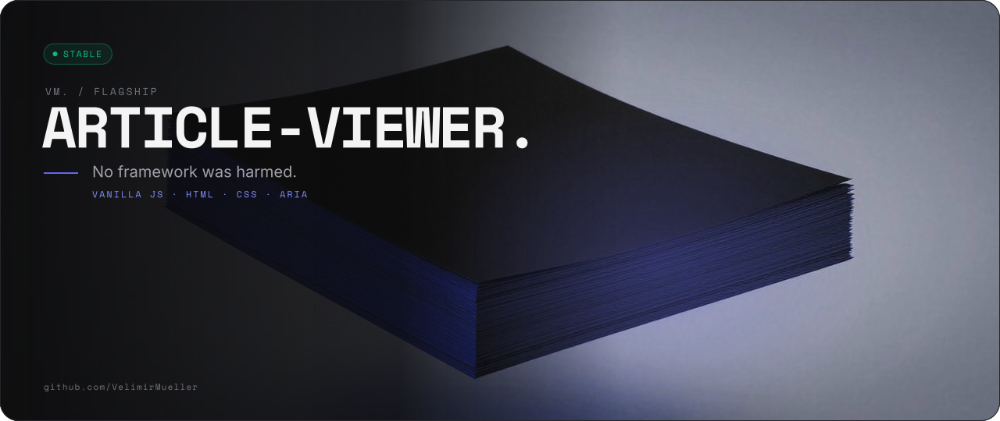
</picture>

<p align="center">

   

</p>

> No framework was harmed.

```text
 ████   █████   ██████  ██████   █████  ██      ██████
██  ██  ██  ██    ██      ██    ██      ██      ██
██████  █████     ██      ██    ██      ██      █████   █████
██  ██  ██ ██     ██      ██    ██      ██      ██
██  ██  ██  ██    ██    ██████   █████  ██████  ██████
██  ██  ██████  ██████  ██   ██  ██████  █████
██  ██    ██    ██      ██   ██  ██      ██  ██
██  ██    ██    █████   ██ █ ██  █████   █████
 ████     ██    ██      ███████  ██      ██ ██
  ██    ██████  ██████   ██ ██   ██████  ██  ██  ██
```

A responsive article viewer in plain HTML, CSS and JS. The UI text is German.
No build step, no dependencies. `node_modules` was not consulted.

<picture>
  <source media="(prefers-color-scheme: dark)" srcset="assets/readme/stats-v2-dark.svg">
  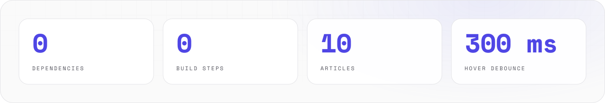
</picture>

<br>

## // 01 WHAT IT DOES

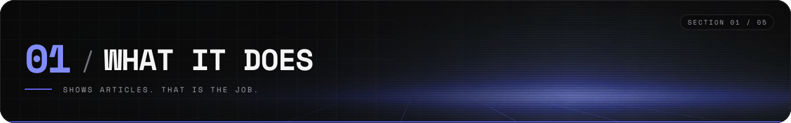

<picture>
  <source media="(prefers-color-scheme: dark)" srcset="assets/readme/features-v2-dark.svg">
  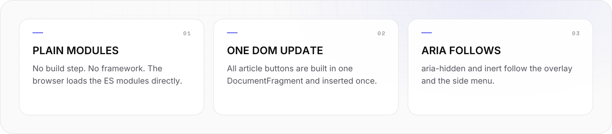
</picture>

- Shows a list of articles in an overlay. Select an article to read its headline and text.
- Loads the articles from `data/articles.json`.
- Works on every screen width (fully responsive).
- Builds the DOM with fragments, so the browser does few updates.
- Sets ARIA attributes dynamically. Debouncers keep hover from stealing focus.

<br>

## // 02 QUICK START

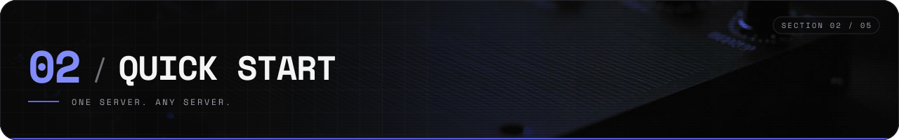

<picture>
  <source media="(prefers-color-scheme: dark)" srcset="assets/readme/start-v2-dark.svg">
  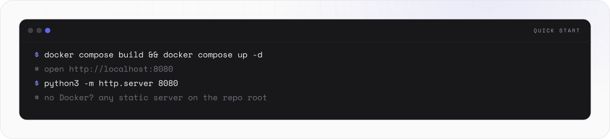
</picture>

With Docker Compose. Then open http://localhost:8080.

```bash
docker compose build && docker compose up -d
```

Without Docker, use any static server on the repo root. The page fetches `/data/articles.json` by absolute path.

```sh
python3 -m http.server 8080
```

- Do not open `index.html` from disk (`file://`). Browsers block ES modules and `fetch()` there.

<br>

## // 03 HOW IT WORKS

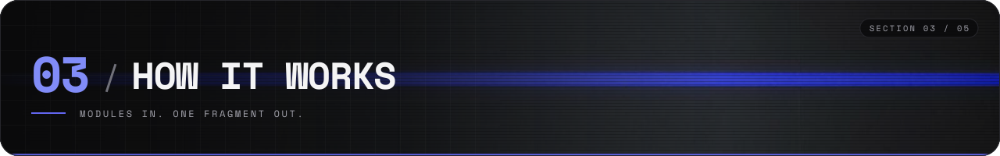

<picture>
  <source media="(prefers-color-scheme: dark)" srcset="assets/readme/flow-v2-dark.svg">
   fetch() -> buttons -> #overlay. aria-hidden and inert follow the overlay. Below 768 px the list sits behind a side-menu toggle." src="assets/readme/flow-v2-light.svg" width="100%">
</picture>

```text
  browser  ·  http://localhost:8080  (nginx:alpine)
     │  GET index.html · css/main.css · js/index.js (ES modules)
     ▼
  ┌────────────────────────────┐   fetch()   ┌───────────────────────┐
  │  index.html module script  │ ──────────▸ │  data/articles.json   │
  │  fetchArticles()           │ ◂────────── │  id · headline · text │
  └─────────────┬──────────────┘    JSON     └───────────────────────┘
                │  createArticleButtons(): buttons built in one
                ▼  DocumentFragment, one DOM update for all of them
  ┌────────────────────────────┐
  │  #overlay                  │  "Alle Kategorien" opens it,
  │  aside: article buttons    │  close button or Escape closes it
  │  article: headline + text  │  focus · click   → show at once
  └────────────────────────────┘  mouseover       → 300 ms debounce

  aria-hidden / aria-inert follow the overlay and side-menu state
  below 768 px the article list sits behind a side-menu toggle
```

<br>

## // 04 USAGE

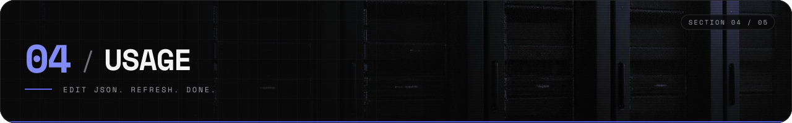

### Articles

- Edit `data/articles.json`. Each entry is `{ "id", "headline", "text" }`.
- The page creates one button per entry at load time.
- `text` goes in as HTML, so `<strong>` and `<br>` work. Put only trusted content there.

### Project layout

```text
index.html            markup + the module script that wires everything up
data/articles.json    the articles: id, headline, text (HTML)
js/articles/          fetch, button factory, button event listeners
js/aria/              aria attributes for the overlay and its buttons
js/utility/           overlay state, side menu, debouncer, Escape key
css/                  variables, layout, components, utilities
fonts/                Roboto Regular + Bold
Dockerfile            nginx:alpine image that serves the folder
docker-compose.yml    port 8080 -> 80, mounts the folder into nginx
```

### Reports

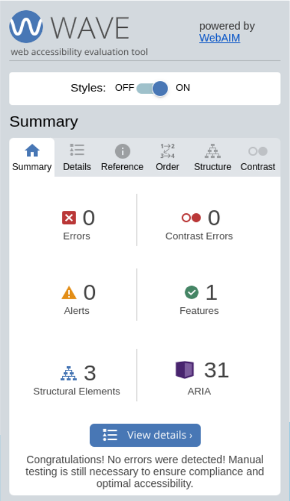

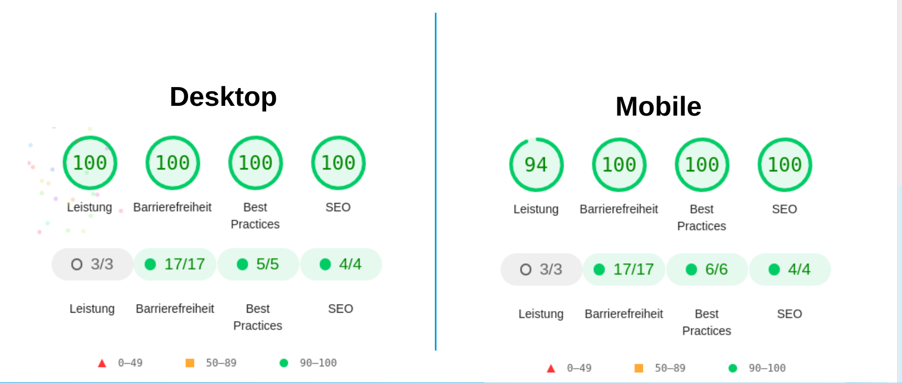

<br>

## // 05 STATUS

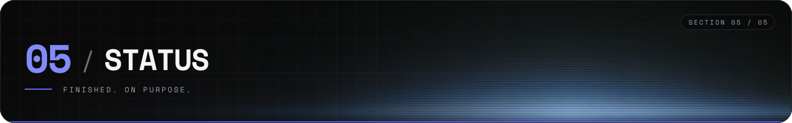

<picture>
  <source media="(prefers-color-scheme: dark)" srcset="assets/readme/status-v2-dark.svg">
  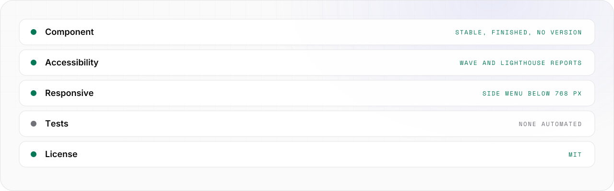
</picture>

- Tests: none automated. The WAVE and Lighthouse reports are in [Reports](#reports).
- License: [MIT](LICENSE).

<br>

```text
-- EOF --------------------------------------- NO FRAMEWORKS WERE HARMED --
```

---

<sub>VM. studio / flagship · open source · look per <code>vm-brand</code> playbook</sub>
